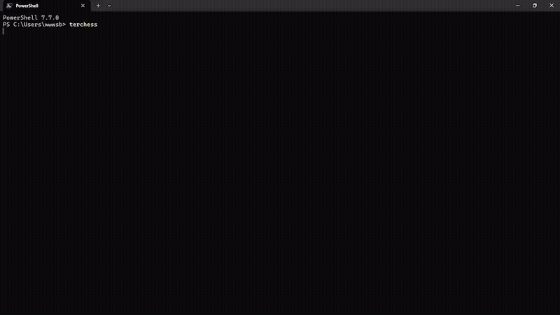

<div align="center">

# ♟️ Terchess

### Terminal + Chess

**Your terminal. Your board. Your imagination.**

A keyboard-first, offline-first chess application for **Windows, macOS, Linux, and Android (Termux)**.

Play Stockfish locally, train your visualization with Blindfold mode, challenge a friend in Hotseat, and review your games — all without leaving the terminal.

[](https://github.com/MaybeSobi/Terchess/actions/workflows/ci.yml)
[](https://www.python.org/)
[](#installation)
[](LICENSE)

</div>

<p align="center">
  
</p>

---

## What makes Terchess different?

Terchess brings the full chess experience into your terminal — including a way to play without seeing the board.

| Board View | Blindfold Mode |
|:--:|:--:|
| A compact, colored chessboard with move highlights, clocks, and move history. | A text-only game: follow algebraic moves and keep the position in your head. |

Choose the way you want to think about chess. Switch display modes in the app.

## Features

- **Play against Stockfish** — run a local engine; no cloud engine or account required.
- **Adjustable engine strength** — Skill Level 0–20 (not a direct Elo rating).
- **Blindfold chess** — play text-only, without a board diagram or piece glyphs.
- **Timed Hotseat** — two players, one device, with chess clocks and increment controls.
- **Game history** — completed games are saved locally in SQLite.
- **PGN tools** — import games, export a selected game or your collection, and replay moves.
- **Offline opening recognition** — identify opening names and ECO codes as the game develops.
- **Persistent settings** — save your preferred side, time control, display mode, skill level, and engine path.
- **Cross-platform terminal UI** — including a compact, portrait-friendly layout for Android via Termux.
- **Offline after setup** — gameplay and opening recognition do not require a network connection.

Stockfish is optional for Hotseat, game history, PGN tools, and opening lookup. The engine is distributed separately; Terchess does not bundle it in the app archive. One-command installers automatically install the official Stockfish 19 build for your platform and verify its SHA-256 checksum and UCI version.

## Installation

### One-command installer

Choose your platform and run the matching command:

**Windows — PowerShell**
```powershell
irm https://raw.githubusercontent.com/MaybeSobi/Terchess/main/install.ps1 | iex
```

**macOS — Terminal**
```bash
bash <(curl -fsSL https://raw.githubusercontent.com/MaybeSobi/Terchess/main/install-macos.sh)
```

**Linux — Terminal**
```bash
bash <(curl -fsSL https://raw.githubusercontent.com/MaybeSobi/Terchess/main/install-linux.sh)
```

**Android — Termux**
```bash
bash <(curl -fsSL https://raw.githubusercontent.com/MaybeSobi/Terchess/main/install-termux.sh)
```

After installation, launch Terchess from any terminal:

```console
terchess
terchess --version
```

> **Engine:** One-command installers fetch the official Stockfish 19 release, verify its SHA-256 digest, and configure it automatically. Manual ZIP installs still require a separate Stockfish 19 download.\n>\n> **Security:** These commands download and execute an installer from this repository. You can inspect the scripts in the repository before running them. Use the dedicated Termux installer on Android; do not use the standard Linux installer inside Termux.

### Manual installation

Terchess requires **Python 3.10+**. To install from a source checkout or extracted ZIP, create a virtual environment and install the project:

```bash
python -m venv .venv
# macOS / Linux
source .venv/bin/activate
# Windows PowerShell: .\.venv\Scripts\Activate.ps1
python -m pip install --upgrade pip
python -m pip install .
terchess
```

See **[INSTALL.md](INSTALL.md)** for complete platform-specific instructions, Stockfish setup, launchers, and troubleshooting.

## Quick start

1. Install Terchess using the command for your platform.
2. The one-command installer configures Stockfish 19 automatically; manual ZIP installs require you to install the engine separately.
3. Run `terchess`.
4. Choose **Play vs Stockfish**, **Hotseat**, or **Game History**.
5. Switch between Board View and Blindfold mode from the main menu.

## Move input

Enter moves in standard algebraic notation or coordinate notation:

```text
e4      Nf3      Qxd5      O-O
e2e4    g1f3
```

Useful in-game commands:

| Command | Action |
|---|---|
| `help` | Show move-entry help |
| `moves` | Print move history |
| `resign` | Resign the current game |
| `menu` | Return to the main menu |

## Project information

- **Python:** 3.10+
- **Platforms:** Windows, macOS, Linux, Android via Termux
- **Engine:** Official Stockfish 19 (optional; installed by one-command installers)
- **Storage:** Local SQLite database and per-user settings
- **License:** GPL-3.0-or-later

## Roadmap

See **[ROADMAP.md](ROADMAP.md)** for planned features and project direction.

## Contributing

Bug reports, compatibility feedback, and improvements are welcome. Please read [CONTRIBUTING.md](CONTRIBUTING.md) and use the issue templates when reporting a problem.

## Security

Please see [SECURITY.md](SECURITY.md) for reporting security issues.

## License

Terchess is distributed under **GPL-3.0-or-later**. See [LICENSE](LICENSE) and [THIRD_PARTY_NOTICES.md](THIRD_PARTY_NOTICES.md) for license and dependency notes.

<div align="center">

**Terchess — Your terminal. Your board. Your imagination.** ♟️

</div>
